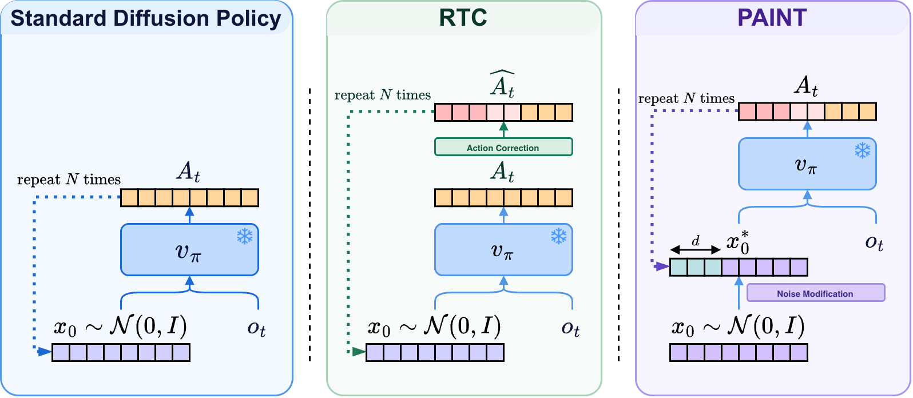

# Start Right, Arrive Right: Asynchronous Execution via Initial Noise Selection

**PAINT** (Prefix-Anchored INiTial Noise) is an inference-time method that lets flow-matching robot policies, such as GR00T-N1.5 and π₀, execute action chunks asynchronously without pauses, jerks, or sudden changes in strategy, and without any gradients, retraining, or policy modification.

> ★ **Accepted**: CoRL 2026 ★ **Spotlight**: Diff4RL @ RSS 2026  ★ arXiv:2606.19774



Robot policies generate **action chunks** (e.g., 50 steps at a time) instead of single actions.
Because the models are large, producing each chunk takes longer than the robot needs to execute part of it.
Naively swapping in a new chunk whenever it arrives leads to problems such as pauses, jerky transitions, or the robot lurching at every chunk boundary.

PAINT solves this by generating the next chunk while the robot keeps executing the current one, and by choosing the **initial noise** so that the new chunk's prefix already agrees with the actions the robot has committed to.

## How PAINT Works (simplified)

While the robot carries out one chunk, the next chunk is being generated. By the time it is ready, the robot has already moved `d` steps (the inference delay), so the first `d` actions of the new chunk must continue the motion that is already underway:

```text
A_{t-1}[s + i] = A_t[i]   for i = 0 … d-1
```

Prior methods such as [Real-Time Chunking (RTC)](https://www.physicalintelligence.company/research/real_time_chunking) satisfy this by **steering** the denoising trajectory toward the executed actions at every step. This can pull the generated chunk off the policy's learned distribution.

PAINT takes a different route: it treats the problem as a **noise selection** problem. Instead of correcting the trajectory mid-generation, it finds the initial noise `x₀*` whose _unmodified_ forward pass naturally produces a prefix-consistent chunk.

1. Run a naive forward pass to get a free chunk
2. Build a target chunk with the executed prefix grafted in
3. Invert the flow ODE (backward Euler) to recover the noise for that target
4. **Re-paint**: keep the inverted noise for the prefix positions, restore the free noise for the tail
5. Run the unmodified policy from this chosen noise. The result is prefix-consistent by construction

In technical terms, PAINT uses three forward-only ODE sweeps and never differentiates through the network, so the policy's velocity field is left untouched.

## Quick Start

### Installation

```bash
https://github.com/cair-vinuni/paint-action-chunking.git
cd paint-action-chunking
```

Then install the dependencies for the policy backbone you want to use (GR00T-N1.5 / N1.7 or π₀ via LeRobot). Support for multiple VLA backbones is available on a separate branch, so check the repository's branches.

### Using PAINT with GR00T

The samplers live in `gr00t/model/gr00t_n1d7/paint.py`. Both take a `velocity_fn` closure instead of a model, so they are independent of how the action head is conditioned.
The snippet below is a simplified pseudo-example of how PAINT operates in your pipeline:

```python
import torch
from gr00t.model.gr00t_n1d7.paint import repaint_sample

# velocity_fn(actions [B, H, D], t_cont in [0, 1)) -> velocity [B, H, D]
def velocity_fn(actions, t_cont):
    return action_head.velocity(actions, t_cont, **conditioning)  # your policy's velocity field

inference_delay = 4  # How many steps of inference latency, calculated from the policy's latency

# Start in a separate thread with the following function
def get_actions():
    while True:
        if should_get_actions:
            # Leftover actions of the previous chunk, time-shifted so index 0
            # is the next action to execute. Only the first `inference_delay`
            # steps are read.
            prev_chunk = action_queue.get_left_over()
            x_0_free = torch.randn(1, horizon, action_dim)  # free noise

            # Generate actions WITH PAINT (no gradients required)
            with torch.no_grad():
                actions, stats = repaint_sample(
                    velocity_fn,
                    x_0_free,
                    prev_chunk,
                    inference_delay=inference_delay,
                    num_steps=10,
                )

            action_queue.merge(actions, inference_delay)

for step in range(num_steps):
    action = action_queue.get()
    execute_action(action)
```

> Use `torch.no_grad()` rather than `torch.inference_mode()`. PAINT itself needs no gradients, but the RTC baseline (`rtc_sample`) requires grad mode, so this keeps both samplers interchangeable.

`stats` reports diagnostics for the call: `repaint_applied` (whether the prefix was re-painted, which only happens when `inference_delay > 0`) and `prefix_error` (the mismatch between the generated prefix and the committed actions).

## Key Parameters

**`inference_delay`**: How many timesteps of inference latency your system has, i.e., how many leading actions of the new chunk are already committed. Must be in `[0, action_horizon]`. When it is `0` there is nothing to anchor and PAINT reduces to a plain forward pass.

**`num_steps`**: Number of Euler steps used for each ODE sweep (≥ 1). PAINT runs three sweeps (forward, inversion, re-painted forward), so it costs about three forward passes of the policy and needs no VJP.

**`prev_action_chunk`**: The leftover of the previous chunk, already time-shifted so index 0 is the next action to execute. Only its first `inference_delay` steps are used.

## Comparison with RTC

The same module also contains `rtc_sample`, a guidance baseline, so both methods can be compared on identical backbones. It accepts the usual RTC knobs (`weights` from `get_prefix_weights`, `max_guidance_weight`, `sigma_d_o`, `action_dim_mask`).

| Aspect                  | RTC (steering)                                  | PAINT (noise selection)                           |
| ----------------------- | ----------------------------------------------- | ------------------------------------------------- |
| **Where it acts**       | Every denoising step                            | Initial noise only                                |
| **Velocity field**      | Modified by a guidance term                     | Never modified                                    |
| **Gradients**           | Needs a VJP of the denoiser at every step       | None, forward-only                                |
| **Cost per chunk**      | 1 forward + 1 VJP per step                      | 3 forward sweeps                                  |
| **Off-distribution risk** | Guidance can pull samples off the learned distribution | Samples come from the unmodified policy |
| **Tunable**             | `max_guidance_weight`, prefix schedule          | `inference_delay`, `num_steps`                    |

## Results

Evaluated on **12 Kinetix simulation environments** and **6 real-world tasks** across three robot embodiments:

| Embodiment       | Tasks                                        |
| ---------------- | -------------------------------------------- |
| Single-arm       | Block Stacking, Toy in Drawer, Banana in Pot |
| Bimanual (ALOHA) | Towel Flinging, Shorts Folding               |
| Humanoid         | Part Placing                                 |

PAINT matches or exceeds RTC (gradient-based steering) on success rate and prefix consistency across GR00T-N1.5 and π₀ backbones, while never modifying the policy's velocity field.

Side-by-side videos of PAINT, RTC, and the baseline on each real-world task are on the [project page](https://cair-vinuni.github.io/paint-action-chunking). The paper is at [docs/paper/PAINT.pdf](docs/paper/PAINT.pdf).

## Citation

```bibtex
@misc{ho2026startrightarriveright,
      title={Start Right, Arrive Right: Asynchronous Execution via Initial Noise Selection}, 
      author={Trong-Bao Ho and Quang-Tan Nguyen and Thien-Loc Ha and Gia-Binh Nguyen and Viet-Thanh Nguyen and Long Dinh and Minh N. Vu and Duy M. H. Nguyen and An Thai Le and Ngo Anh Vien},
      year={2026},
      eprint={2606.19774},
      archivePrefix={arXiv},
      primaryClass={cs.RO},
      url={https://arxiv.org/abs/2606.19774}, 
}
```
